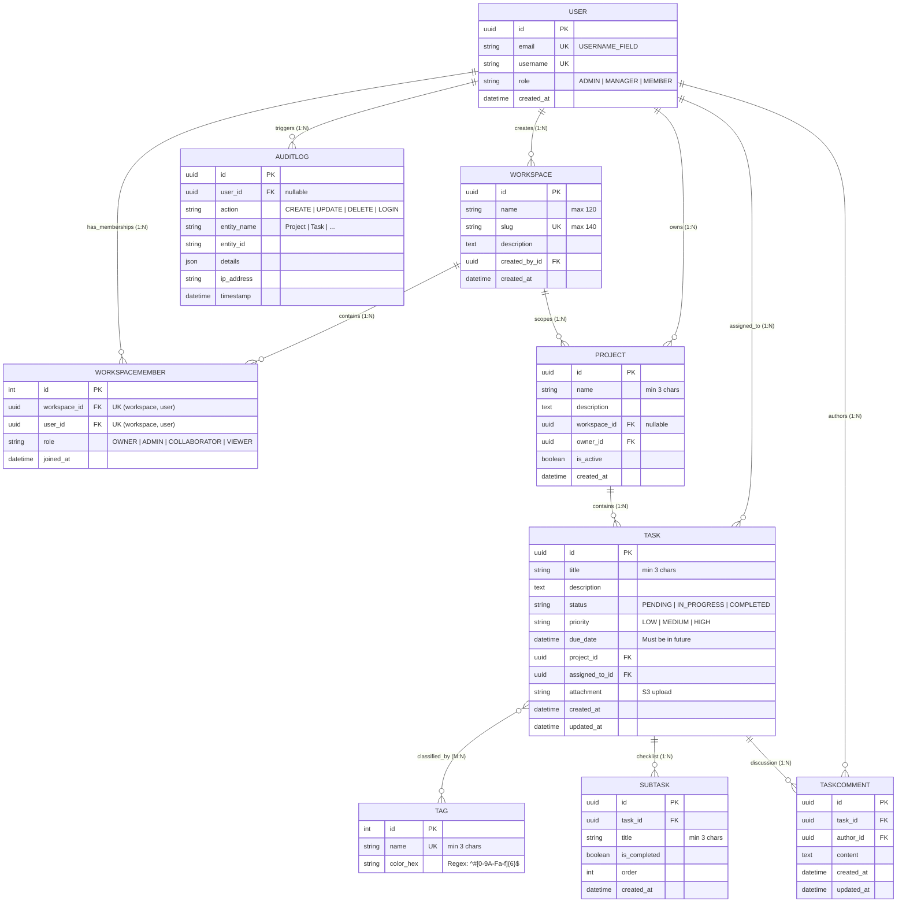

# EVA4 - Enterprise Task & Project Management REST API
### Backend Profesional Django REST Framework, DevSecOps, Amazon RDS & S3 (9 Entidades Relacionales)

[](https://www.python.org/)
[](https://www.djangoproject.com/)
[](https://www.django-rest-framework.org/)
[](https://aws.amazon.com/rds/)
[](https://aws.amazon.com/s3/)
[](https://owasp.org/)

---

## 1. Arquitectura del Sistema y Topología AWS

El sistema está diseñado bajo una arquitectura desacoplada y orientada a microservicios, optimizada para ejecutarse en la nube de **Amazon Web Services (AWS)** con separación estricta de responsabilidades:

```mermaid
flowchart TD
    subgraph ClientLayer ["Capa de Cliente / Frontend"]
        FE["Frontend SPA (React/Vue/Next.js)<br/>Instancia AWS EC2"]
    end

    subgraph GatewayLayer ["Capa de Entrada y Ruteo"]
        AGW["Amazon API Gateway<br/>(HTTP API / Reverse Proxy)"]
    end

    subgraph BackendEC2 ["Instancia AWS EC2 (Backend)"]
        NGINX["Nginx (Puerto 80)<br/>Reverse Proxy + Security Headers + Static/Media"]
        SOCK["Unix Domain Socket<br/>/home/ubuntu/apps/backend/backend.sock"]
        GUNICORN["Gunicorn WSGI (3 Workers)<br/>Systemd Service: gunicorn.service"]
        DJANGO["Django 5.0+ / DRF Core Application<br/>(JWT Auth, RBAC, 9 Entidades, Auditing)"]

        NGINX -->|proxy_pass| SOCK
        SOCK --> GUNICORN
        GUNICORN --> DJANGO
    end

    subgraph DataAndStorage ["Capa de Persistencia Gestionada AWS"]
        RDS[("Amazon RDS PostgreSQL<br/>Cifrado TLS (sslmode=require)")]
        S3["Amazon S3 Bucket<br/>(Media/Static, Cifrado AES-256,<br/>URLs Prefirmadas Privadas)"]
    end

    FE -->|JSON / Bearer JWT| AGW
    AGW -->|Tráfico HTTP/REST| NGINX
    DJANGO -->|Consultas SQL (psycopg2-binary)| RDS
    DJANGO -->|django-storages (boto3)| S3
```

---

## 2. Modelo de Datos Relacional Completo (9 Entidades Normalizadas)

La arquitectura de datos de la aplicación `core` se compone de **9 entidades relacionales** completamente integradas:



### Especificación de las 9 Entidades

1. **`User` (hereda de `AbstractUser`):** Llave primaria UUID, login por email normalizado, roles de sistema (`ADMIN`, `MANAGER`, `MEMBER`), hasheo criptográfico nativo con `PBKDF2PasswordHasher`.
2. **`Workspace` (Organización / Espacio de Trabajo):** Llave primaria UUID, nombre, slug único para URLs amigables, descripción y relación hacia el usuario creador (`created_by`).
3. **`WorkspaceMember` (Membresía por Espacio):** Asocia usuarios a espacios con roles específicos (`OWNER`, `ADMIN`, `COLLABORATOR`, `VIEWER`), con restricción de unicidad estricta `unique_together = ('workspace', 'user')`.
4. **`Project`:** Agrupa tareas bajo un propietario (`owner`), vinculado opcionalmente a un `Workspace` (`null=True, blank=True, on_delete=SET_NULL`).
5. **`Tag`:** Taxonomía de tareas con código de color hexadecimal validado por expresión regular (`^#[0-9A-Fa-f]{6}$`).
6. **`Task`:** Tareas asignadas, con estado, prioridad, fecha de vencimiento validada (futura), adjunto para S3 y contadores de subtareas y comentarios en el serializador.
7. **`Subtask`:** Subtareas tipo checklist vinculadas a una tarea, con estado completado (`is_completed`) y ordenación personalizable (`order`).
8. **`TaskComment`:** Hilo de discusión y comentarios en tareas, con autor y marcas temporales de edición.
9. **`AuditLog`:** Registro inmutable de seguridad y operaciones, registrando automáticamente usuario, acción (`CREATE`, `UPDATE`, `DELETE`), entidad afectada, ID, detalles JSON y dirección IP del cliente.

---

## 3. Matriz de Endpoints y Referencia de la API

Todos los endpoints están prefijados bajo `/api/v1/`:

| Método | Endpoint | Permiso Requerido | Descripción |
| :--- | :--- | :--- | :--- |
| `POST` | `/api/v1/auth/register/` | `AllowAny` | Registro público. Valida fortaleza de clave; **nunca** retorna el campo `password`. |
| `POST` | `/api/v1/auth/token/` | `AllowAny` | Login JWT. Retorna tokens `access` (60 min) y `refresh` (24 h). |
| `POST` | `/api/v1/auth/token/refresh/` | `AllowAny` | Emite un nuevo token `access` a partir de un `refresh` válido. |
| `GET` | `/api/v1/auth/me/` | `IsAuthenticated` | Retorna los detalles del usuario autenticado en la sesión actual. |
| `GET/POST` | `/api/v1/workspaces/` | `IsAuthenticated` | Listado y creación de Espacios de Trabajo (asigna automáticamente al creador como `OWNER`). |
| `GET/PUT/PATCH/DELETE` | `/api/v1/workspaces/{id}/` | `IsOwnerOrAdmin` | Modificación y eliminación reservada al creador del espacio o `ADMIN`. |
| `GET/POST` | `/api/v1/workspace-members/` | `IsAuthenticated` | Gestión de miembros y roles por espacio (soporta `?workspace={UUID}`). |
| `GET/PUT/PATCH/DELETE` | `/api/v1/workspace-members/{id}/`| `IsOwnerOrAdmin` | Modificación o eliminación de membresía. |
| `GET/POST` | `/api/v1/projects/` | `IsAuthenticated` | Lista y creación de proyectos (con auditoría automática). |
| `GET/PUT/PATCH/DELETE` | `/api/v1/projects/{id}/` | `IsOwnerOrAdmin` | Modificación/borrado por `owner` o `ADMIN` (con auditoría automática). |
| `GET/POST` | `/api/v1/tags/` | `IsAuthenticated` | Lista y creación de etiquetas con código hex validado. |
| `GET/PUT/PATCH/DELETE` | `/api/v1/tags/{id}/` | `IsOwnerOrAdmin` | Modificación y borrado de etiquetas (restringido a `ADMIN`). |
| `GET/POST` | `/api/v1/tasks/` | `IsAuthenticated` | Lista y creación de tareas con filtros: `?status=`, `?priority=`, `?project=`. |
| `GET/PUT/PATCH/DELETE` | `/api/v1/tasks/{id}/` | `IsOwnerOrAdmin` | Modificación/borrado por el propietario del proyecto o `ADMIN`. |
| `GET/POST` | `/api/v1/comments/` | `IsAuthenticated` | Consulta y creación de comentarios en tareas (soporta `?task={UUID}`). |
| `GET/PUT/PATCH/DELETE` | `/api/v1/comments/{id}/` | `IsOwnerOrAdmin` | Modificación/borrado por el autor del comentario o propietario del proyecto. |
| `GET/POST` | `/api/v1/subtasks/` | `IsAuthenticated` | Consulta y creación de subtareas / checklist (soporta `?task={UUID}`). |
| `GET/PUT/PATCH/DELETE` | `/api/v1/subtasks/{id}/` | `IsOwnerOrAdmin` | Modificación/borrado por el propietario del proyecto o `ADMIN`. |
| `GET` | `/api/v1/audit-logs/` | `IsAuthenticated` | Consulta de auditoría de seguridad (`ADMIN` ve todos; usuarios regulares solo los suyos). |
| `GET` | `/api/v1/health/` | `AllowAny` | Health check para AWS ALB/API Gateway. Retorna `{"status": "ok", "database": "connected"}`. |
| `GET` | `/api/v1/schema/` | `AllowAny` | Esquema OpenAPI 3.0 en formato JSON/YAML. |
| `GET` | `/api/v1/docs/` | `AllowAny` | Interfaz gráfica interactiva Swagger UI. |

---

## 4. Auditoría Automática de Seguridad (`core/audit.py`)

El sistema incluye un mecanismo transparente de auditoría que registra de forma inmutable cada operación de ciclo de vida (`CREATE`, `UPDATE`, `DELETE`) sobre entidades críticas (`Project`, `Task`):
- **Usuario causante:** Extraído del contexto de la petición autenticada (`request.user`).
- **Dirección IP del cliente:** Detectada analizando cabeceras de proxy inverso (`HTTP_X_FORWARDED_FOR`) o conexión directa (`REMOTE_ADDR`).
- **Detalles estructurados:** Payload JSON con nombres, títulos, estados y relaciones clave.
- **Acceso controlado:** El endpoint `/api/v1/audit-logs/` es estrictamente de solo lectura. Los usuarios con rol `ADMIN` pueden auditar todos los eventos del sistema, mientras que los usuarios estándar solo tienen visibilidad de sus propias acciones.

---

## 5. Medidas de Seguridad DevSecOps (SAST / DAST)

### Cumplimiento OWASP Top 10 & DAST (OWASP ZAP)
- **Cabeceras de Seguridad HTTP:**
  - `X-Content-Type-Options: nosniff`: Evita ataques MIME-sniffing.
  - `X-Frame-Options: DENY`: Previene ataques de Clickjacking.
  - `Referrer-Policy: strict-origin-when-cross-origin`: Minimiza fuga de URLs internas.
  - `server_tokens off;` (en Nginx): Oculta versiones exactas del servidor para evitar finger-printing.
- **Seguridad en Cookies y Sesiones:**
  - `SESSION_COOKIE_HTTPONLY = True` y `CSRF_COOKIE_HTTPONLY = True`: Impide el acceso a cookies desde JavaScript.
  - Soporte para `SESSION_COOKIE_SECURE` y `CSRF_COOKIE_SECURE` en entornos con HTTPS/TLS.
- **Aislamiento de Almacenamiento (Amazon S3):**
  - Cifrado en reposo `AES256` en el bucket S3 (`ServerSideEncryption`).
  - ACLs públicas deshabilitadas (`AWS_DEFAULT_ACL = None`).
  - URLs firmadas temporales para archivos multimedia (`AWS_QUERYSTRING_AUTH = True`).

### Análisis Estático de Seguridad (SAST - SonarQube)
El archivo `sonar-project.properties` incluye:
- Análisis exclusivo de directorios de código fuente `core/` y `backend_project/`.
- Exclusión estricta de entornos virtuales (`venv/**`), migraciones autogeneradas (`**/migrations/**`) y archivos compilados (`__pycache__/**`).
- Reglas de calidad y seguridad para Python 3.11/3.12.

---

## 6. Configuración y Ejecución en Entorno Local

### 1. Clonar el repositorio y crear entorno virtual
```bash
git clone <URL_REPOSITORIO>
cd EVA4

# En Linux / macOS:
python3 -m venv .venv
source .venv/bin/activate

# En Windows (PowerShell):
python -m venv .venv
.\.venv\Scripts\Activate.ps1
```

### 2. Instalar dependencias
```bash
pip install --upgrade pip
pip install -r requirements.txt
```

### 3. Configurar variables de entorno locales
```bash
cp .env.example .env
# Para desarrollo rápido en PC, mantén DB_ENGINE vacío (usará SQLite3) y DEBUG=True en .env
```

### 4. Ejecutar migraciones y crear superusuario
```bash
python manage.py makemigrations core
python manage.py migrate
python manage.py createsuperuser
```

### 5. Iniciar servidor de desarrollo
```bash
python manage.py runserver 0.0.0.0:8000
```
- API Base: `http://localhost:8000/api/v1/`
- Swagger UI: `http://localhost:8000/api/v1/docs/`
- Health Check: `http://localhost:8000/api/v1/health/`

---

## 7. Despliegue en Producción en AWS EC2 (Ubuntu 22.04 / 24.04 LTS)

### Prerrequisitos en AWS
1. **Instancia EC2 Backend (Ubuntu):** Security Group con puerto 22 (SSH), 80 (HTTP desde API Gateway o VPC) y 443.
2. **Amazon RDS (PostgreSQL):** Security Group permitiendo inbound en el puerto `5432` desde el Security Group de la EC2 Backend.
3. **Amazon S3:** Bucket creado con cifrado AES-256 y credenciales IAM configuradas.
4. **Amazon API Gateway:** HTTP API configurada con integración proxy hacia `http://<EC2-BACKEND-IP>/{proxy}`.

---

### Procedimiento de Despliegue Automatizado con `deploy/deploy.sh`

1. **Conéctate por SSH a la instancia EC2 Backend:**
   ```bash
   ssh -i "tu-llave.pem" ubuntu@<EC2_PUBLIC_IP>
   ```

2. **Clona el repositorio en `/home/ubuntu/apps/backend`:**
   ```bash
   sudo mkdir -p /home/ubuntu/apps
   sudo chown -R ubuntu:ubuntu /home/ubuntu/apps
   git clone <URL_REPOSITORIO> /home/ubuntu/apps/backend
   cd /home/ubuntu/apps/backend
   ```

3. **Crea y edita el archivo `.env` de producción:**
   ```bash
   cp .env.example .env
   nano .env
   ```
   Configura tus variables reales de Amazon RDS y S3.

4. **Ejecuta el script de despliegue:**
   ```bash
   chmod +x deploy/deploy.sh
   ./deploy/deploy.sh
   ```

El script `deploy.sh` resuelve automáticamente los permisos de socket para evitar errores `502 Bad Gateway`:
```bash
sudo usermod -aG ubuntu www-data
sudo chmod 750 /home/ubuntu
sudo chmod -R 770 /home/ubuntu/apps
```

---

## 8. Ejecución de la Suite de Pruebas Automatizadas

La suite incluye **39 pruebas unitarias** que cubren las 9 entidades, autenticación JWT, permisos `IsOwnerOrAdmin`, validaciones de fecha, serializadores, subtareas, comentarios y el sistema de auditoría automática:

```bash
# Ejecutar todas las pruebas del core:
python manage.py test core

# Ejecutar con salida detallada:
python manage.py test core.tests -v 2
```

---

## 9. Licencia y Buenas Prácticas
Proyecto desarrollado conforme a estándares de arquitectura de software para misión crítica, directrices **DevSecOps**, **OWASP Top 10** y las mejores prácticas de desarrollo con **Django REST Framework**.
